# MineSweepML

A Minesweeper player that learns from the games it plays, built to train on a
CPU-only machine. A local web interface lets you create and manage bots, start
and control training, watch it live, replay simulated games at any speed and
benchmark any checkpoint against a rule-based solver.

- **Learning from its own games:** a fully convolutional residual network in
  PyTorch predicts, for every covered cell, the probability that it hides a
  mine, and clicks the safest one. The games it plays are labelled by the
  simulator, which knows where the mines are, so every position is a training
  example for every covered cell at once.
- **One network for every board size:** no dense layers, so the same weights
  play Beginner (9x9), Intermediate (16x16), Expert (30x16) and custom boards.
- **Bots:** create, edit, fork and delete bots from the web interface. A bot
  keeps its network size, difficulty mix, exploration schedule and learning
  rate, plus its checkpoints and metrics.
- **Training control:** set the length by number of games, by wall-clock time,
  or "until I press Stop". Pause, resume and stop gracefully, and continue any
  bot later. Intensity presets (Light / Balanced / Heavy / Hardcore) scale with
  your core count.
- **Live dashboard** over WebSocket: loss, win rate per difficulty, benchmark
  results per checkpoint, throughput, CPU per core, and every game in progress,
  with the network's mine probabilities on the one you follow.
- **Simulate and replay:** play single games or batches of thousands, then
  replay any of them from 0.25x to 1000x (or jump to the end), step through
  it move by move, and overlay the network's or the solver's P(mine).
- **GIF export** of any replay, from the web interface or the command line,
  for READMEs like this one.
- **Benchmark:** win rate with a 95% interval on fixed seeded boards that
  training never sees, next to a rule-based solver and a random clicker,
  with optional counts of forced guesses and blunders.

## Watch it play

| A fresh bot: its first Expert game | After 29,454 games (45 minutes of training) |
|---|---|
| 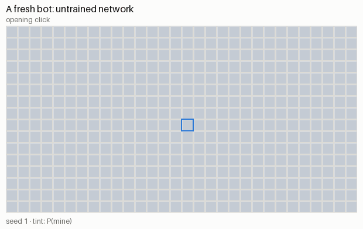 | 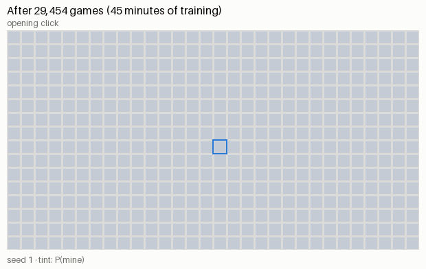 |

Both games are on the same Expert board (30x16, 99 mines, seed 1), opened on
the centre cell. The covered cells are tinted by the network's own P(mine),
green for safe and orange for likely mines, and the outlined cell is its next
click. The fresh bot is the untrained network that every new bot starts as
(`ckpt_0000000g.pt`): its estimates are noise, and it hits a mine on its fifth
move. The trained one is the final checkpoint of the bot `Sweeper`, the
bundled `models/best.pt`: 29,454 games over 45 minutes of training on a
12-thread laptop with the Hardcore preset. It clears the board in 194 moves.
It wins about 40% of Expert boards (see [Results](#results)); seed 1 is the
first seed it wins, and it won 11 of the first 40. To render both games from
your own bot:

```bash
python -m minesweepml train --bot Sweeper --preset hardcore --time 45m   # Ctrl+C or Stop when you like
python -m minesweepml gif Sweeper/ckpt_0000000g.pt --difficulty expert --seed 1 --fps 4 --out docs/games/fresh-bot.gif
python -m minesweepml gif Sweeper --difficulty expert --seed 1 --fps 10 --out docs/games/sweeper.gif
```

`gif` takes a bot name (its latest checkpoint), any checkpoint file or label,
or `solver` / `random`. The **Export GIF** button on the Simulate tab renders
the replay you are watching, overlay included.

## How it works

```
                 +-------------------------- trainer process ---------------------------+
                 |  replay buffer per difficulty (positions + true mine maps)            |
  finished  ---> |  AdamW on binary cross-entropy over the covered cells                 |
  games          |  publishes new weights every 25 steps  ----------------------------+  |
  (positions,    |  pauses the workers while training is behind                       |  |
   mine maps)    |  checkpoint every 10 min, benchmark every 10 min                   |  |
                 +--------------------------------------------------------------------|--+
                        ^                                                             |
                        |                                                             v
          +-------------+-------------+    ... one per worker ...    +-------------------------+
          | worker 0: 32 games at once |                              | worker N-1              |
          | one batched forward pass   |                              |                         |
          | per move, all 32 games     |                              |                         |
          +----------------------------+                              +-------------------------+

  web server (FastAPI, not niced)  <-- events (mp.Queue) --  trainer
         |  WebSocket push
         v
  browser: bots, training controls, live charts, live games, replays, benchmarks
```

1. **Encode** what a player sees: each cell one-hot over 11 states (off-board,
   covered, 0 to 8), plus a plane with the mine density of the covered cells
   (mines / covered cells). Every board gets a ring of off-board cells, so
   edges look the same to the network on every board size.
2. **Predict.** A 3x3 stem and 6 residual blocks of 32 channels (114,913
   parameters) end in a 1x1 convolution: one logit per cell, P(mine) after a
   sigmoid. Six blocks see 27 x 27 cells around each cell, more than any
   local Minesweeper deduction needs.
3. **Play.** Every game opens on the centre cell, and that cell and its
   neighbours are mine-free (the rule of modern clients), so the first click
   always opens an area. After that the network clicks the covered cell with
   the lowest P(mine). With a small probability (20% falling to 1% over the
   first 20,000 games) it clicks a random covered cell instead, so it also sees
   positions its own choices would avoid. It never places flags: Minesweeper
   is won by revealing every safe cell.
4. **Learn.** A quarter of the positions before a move are stored with the
   board's true mine layout as the target. The loss is the binary
   cross-entropy between the predicted and the true mine map over the covered
   cells. Its minimum is exactly P(mine | what is visible) under the board
   generator, so a lower loss means safer clicks. Boards are flipped (and
   transposed on square boards) at random, since Minesweeper is symmetric
   under all of them. Each stored position is used about twice. When three
   benchmarks in a row do not beat the best score since the last change, the
   learning rate drops to 30%, but never below 1e-4.
5. **Measure.** A separate process regularly plays the newest checkpoint on
   200 fixed benchmark boards per difficulty and records its win rate.

This is learning from self-generated, simulator-labelled data, not
reward-based reinforcement learning: the network never sees a score, only
where the mines were. That is what makes it trainable in minutes on a CPU.

### Why training, not playing, is the bottleneck

In a game like chess, a tree search spends dozens of network evaluations per
move, so the self-play workers dominate the compute. Here a move costs a
single forward pass, while a stored position costs a forward and a backward
pass (about three forward passes), twice over. So the trainer gets most of
the cores, and workers pause by themselves whenever training falls behind the
positions they have sent. On the 12-thread laptop of the reported run, one
training step (256 Expert boards) takes 1.0 s on 2 threads and 0.63 s on 4,
and no faster on 6 or 8, so presets cap the trainer at 4 threads.

### Sizing for a CPU

Network evaluations, measured once on that laptop (one core, 32 Expert boards
per batch, channels-last memory layout):

| Network | Parameters | Moves/s per core |
|---|---|---|
| 4 x 32 | 77,793 | 526 |
| **6 x 32** | **114,913** | **364** |
| 4 x 48 | 171,985 | 256 |
| 6 x 48 | 255,313 | 178 |
| 6 x 64 | 451,009 | 111 |
| 8 x 64 | 598,977 | 83 |
| 8 x 96 | 1,340,833 | 39 |

6 x 32 has the same 27-cell receptive field as 6 x 64 at about 3.3 times the
speed. With hours of CPU rather than weeks of GPU, more games beat more
capacity. A bot's size is set when it is created (*New bot* -> *Network
size*, or `--blocks/--channels`).

## Install

Developed and tested with Python 3.14.4 on Linux. No GPU is needed.

```bash
git clone https://github.com/PharellJay/MineSweepML.git
cd MineSweepML
python3.14 -m venv .venv
source .venv/bin/activate
python -m pip install --upgrade pip

# 1. PyTorch, CPU-only build: a much smaller download without the CUDA libraries
pip install torch==2.15.0 --index-url https://download.pytorch.org/whl/cpu

# 2. Everything else (pinned versions)
pip install -r requirements.txt

# 3. Check the install
python -m pytest -q
```

If you skip step 1, `pip install -r requirements.txt` installs the default
PyPI build of torch, which bundles CUDA. It also runs on a CPU-only machine,
but downloads several GB.

The web interface needs no build step and no internet access: it is plain
HTML, CSS and JavaScript in `minesweepml/static/`, with no third-party
libraries.

## Starting the web interface

The whole web interface (Bots, Train, Simulate and Benchmark tabs) is served
by one command. Nothing else has to run first: there is no separate frontend
build, database server or background service.

```bash
cd ~/path/to/MineSweepML           # 1. the repository root (the folder with README.md)
source .venv/bin/activate          # 2. the virtual environment from "Install"
python -m minesweepml serve        # 3. start the server
```

After about 1.5 seconds your default browser opens **http://127.0.0.1:8000/**.
Leave the terminal open: the website runs only while this command runs.

- **Start from the repository root.** Bots are read from and written to
  `runs/` *relative to the current folder*. To keep them somewhere else, set
  `MINESWEEPML_RUNS=/some/folder`.
- **Activate the virtual environment** in every new terminal, or call its
  Python directly: `.venv/bin/python -m minesweepml serve`.

| Option | Default | What it does |
|---|---|---|
| `--port N` | `8000` | Port to listen on, e.g. `--port 8001` if 8000 is taken. |
| `--host ADDR` | `127.0.0.1` | Address to listen on. The default is reachable only from this computer. |
| `--no-browser` | off | Don't open a browser window (headless machine, SSH). |

Tabs can be opened directly: `http://127.0.0.1:8000/#train`, `#simulate`,
`#benchmark`.

**Stopping.** Press **Ctrl+C** in the terminal that runs the server. A running
training session is stopped gracefully first (unfinished games are discarded,
a checkpoint and the replay buffer are saved), and a running benchmark or
simulation batch is cancelled. Closing the browser tab stops nothing: open
the URL again and the dashboard reconnects. Closing the terminal window kills
the server without the graceful stop, which loses the progress since the
last checkpoint, so prefer Ctrl+C.

**Continuing where you left off.** Everything the page shows is stored in
`runs/` (one folder per bot: checkpoints, settings and `metrics.db` with the
chart history, plus `runs/benchmarks.json`). Restart the server, pick the bot
on the Train tab and press **Start**: training continues from its latest
checkpoint. `runs/` is in `.gitignore`, so it is never pushed. A fresh clone
contains only the bundled `models/best.pt`.

**From another computer.** The server has no login and no access control:
anyone who can reach it can start and stop training or delete bots. Keep the
default `127.0.0.1` and use an SSH tunnel:

```bash
python -m minesweepml serve --no-browser          # on the training machine
ssh -L 8000:127.0.0.1:8000 user@training-machine  # on your laptop, then open http://127.0.0.1:8000/
```

| Symptom | Cause and fix |
|---|---|
| `ModuleNotFoundError: No module named 'torch'` (or `fastapi`, ...) | The virtual environment isn't active: `source .venv/bin/activate`, or install the requirements. |
| `No module named minesweepml` | You're not in the repository root. `cd` into the folder with `minesweepml/` and `README.md`. |
| `[Errno 98] address already in use` | Another program uses port 8000. Stop it or use `--port 8001`. |
| The page loads but my bots are missing | The server was started outside the repository root, or `runs/` wasn't copied along. |
| The status says "running · catching up" | Normal: the workers are paused for a moment while training catches up with the games they sent. |
| The rest of the computer feels slow while training | Pick a lighter preset. Training processes lower their own priority; the web server keeps normal priority. |

## Quick start

```bash
cd MineSweepML && source .venv/bin/activate
python -m minesweepml serve            # opens http://127.0.0.1:8000/
```

In the browser, create a bot on the **Bots** tab (or just go to **Train**,
which creates one for you), pick a preset and a duration and press **Start**.
The **Simulate** tab plays and replays games of any checkpoint, including the
bundled `models/best.pt`, right after cloning.

The same from the terminal:

```bash
python -m minesweepml train --bot Sweeper --preset hardcore --time 45m   # create or continue a bot
python -m minesweepml train --bot Sweeper --games 20000                  # continue it for 20,000 more games
python -m minesweepml train --bot Big --blocks 8 --channels 64           # a bigger network
python -m minesweepml train --bot Experts --mix expert=1                 # train on Expert boards only
python -m minesweepml train --fork runs/Sweeper/checkpoints/ckpt_0100000g.pt --bot Sweeper2
python -m minesweepml evaluate Sweeper --boards 1000 --quality           # benchmark the latest checkpoint
python -m minesweepml evaluate solver --boards 1000                      # ... or a baseline
python -m minesweepml simulate models/best.pt --difficulty expert --games 500
python -m minesweepml gif models/best.pt --difficulty expert --seed 3 --out docs/games/x.gif
python -m minesweepml list                                               # presets, bots, checkpoints
python -m minesweepml report --bot Sweeper --export-best                 # regenerate Results below
```

## Training settings

**Duration.** Set exactly one of `--games N`, `--time 2h` (also `90m`,
`1h30m`, `45s`), or nothing, which means until stopped. Limits apply to the
current session. Paused time does not count against a time limit.

**Intensity.** Presets are computed from the number of logical CPUs:

| Preset | Workers | Trainer threads | Batch | Niceness | Replay buffer | On 8 CPUs | On 12 CPUs | On 16 CPUs |
|---|---|---|---|---|---|---|---|---|
| Light | cpus / 12 | cpus / 6, at most 2 | 128 | 19 | 100k | 1 + 1 | 1 + 2 | 1 + 2 |
| Balanced | cpus / 6 | cpus / 4, at most 4 | 256 | 10 | 200k | 1 + 2 | 2 + 3 | 2 + 4 |
| Heavy | cpus / 4 | cpus / 3, at most 4 | 256 | 8 | 300k | 2 + 2 | 3 + 4 | 4 + 4 |
| Hardcore | cpus / 2 - 1 | cpus / 3, at most 4 | 256 | 5 | 400k | 3 + 2 | 5 + 4 | 7 + 4 |

Override any value with `--workers`, `--threads`, `--batch-size`, `--nice`,
`--buffer-size` and `--parallel-games`, or under *Manual overrides* in the web
interface.

**Bot settings** belong to a bot rather than to a session. They are set when
the bot is created and can be changed later on the Bots tab (*Edit*) or by
passing them to `train`:

| Setting | Default | Meaning |
|---|---|---|
| Network size | 6 x 32 | Residual blocks x channels. Fixed once the bot exists. |
| Difficulty mix | Beginner 20%, Intermediate 30%, Expert 50% | Share of each board in training games. |
| Exploration | 20% -> 1% over 20,000 games | Share of random clicks. |
| Positions stored | 25% | Share of the positions before a move kept for training. |
| Continue after a mine | 0% | Share of training games that carry on with a random safe cell after hitting a mine, so a young bot also sees late-game positions. Such games still count as lost. |
| Learning rate | 1e-3 | AdamW, lowered on plateaus (see How it works). |
| First click | opens an area | `--first-click safe-cell` keeps only the clicked cell mine-free. |

## Measuring strength

Win rate is an absolute measure in Minesweeper, so no rating system is
needed. The benchmark plays every player on the same boards: board *i* uses
seed 2^40 + *i*, opened on the centre cell. Training seeds are below 2^32, so
training never sees a benchmark board. Results come with a Wilson 95%
interval, and `--quality` (or the checkbox on the Benchmark tab) also counts,
per game:

- **forced guesses:** moves made when no covered cell was provably safe;
- **blunders:** mines hit while a provably safe cell existed.

Both are judged by the rule-based solver, which is also the main yardstick.
It plays every cell that single-number and subset rules prove safe. When
there is none, it computes the exact P(mine) of every covered cell: the
frontier splits into independent groups of cells, each enumerated by
backtracking and counted by its number of mines, and the groups and the
untouched interior are combined under the global mine count. It then clicks
the lowest probability. A test checks those probabilities against brute-force
enumeration of every mine layout.

## UI tour

**Bots tab**

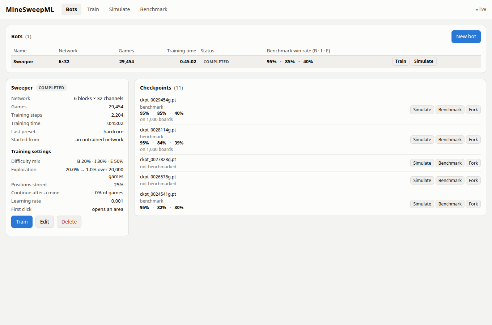

Every bot with its network size, games, training time and its latest
benchmark (Beginner · Intermediate · Expert win rate). Click a bot for its
settings and checkpoints:

- *Train* opens it on the Train tab, *Edit* changes its name and training
  settings (difficulty mix, exploration, stored positions, continue after a
  mine, learning rate, first-click rule; the network size is fixed), and
  *Delete* removes it with all its checkpoints and metrics after a
  confirmation. Renaming and deleting are refused while the bot trains.
- Each checkpoint has *Simulate*, *Benchmark* and *Fork* (a new bot that
  starts from a copy of it).
- *New bot* creates one: name, network size, difficulty mix and learning
  settings, untrained or from any checkpoint.

**Train tab**

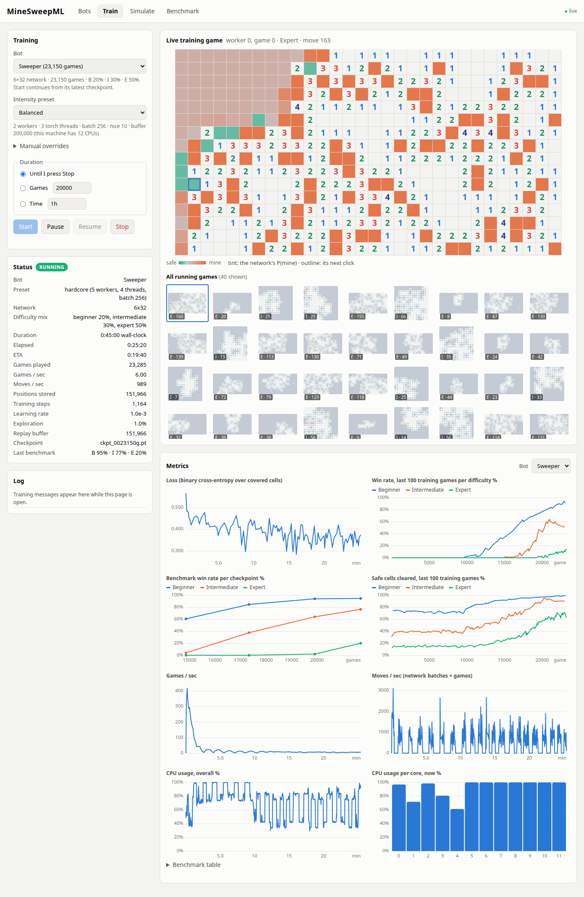

The reported run 25 minutes in, at 23,150 games.

- *Training* (left): the bot to train (or a new one), the intensity preset
  with its resolved values, manual overrides, the duration (until stop / N
  games / time) and Start / Pause / Resume / Stop. Start continues the bot
  from its latest checkpoint.
- *Status*: state, preset, network, difficulty mix, elapsed time, ETA, games
  and games/s, moves/s, positions stored, training steps, learning rate,
  exploration, replay buffer, checkpoint and the last benchmark. "Catching
  up" means the workers are paused for a moment while training catches up.
- *Live training game*: the game you follow, with the network's P(mine) on
  every covered cell and its next click outlined. Below it a thumbnail of
  every running game; click one to follow it.
- *Metrics*: loss, win rate and cleared share of the last 100 training games
  per difficulty, benchmark win rate per checkpoint, games/s, moves/s, CPU
  overall and per core, and a benchmark table. The *Bot* selector shows the
  history of any bot: metrics are stored per bot in SQLite
  (`runs/<bot>/metrics.db`), so charts survive restarts.

**Simulate tab**

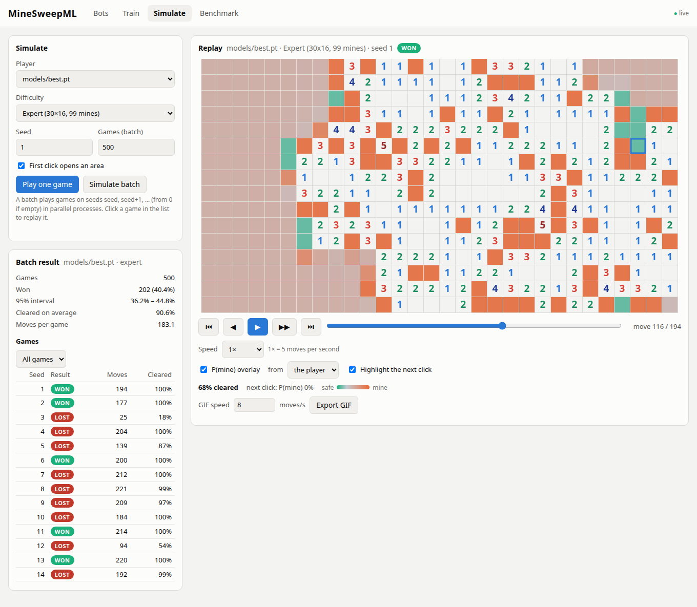

The trained bot's 500-game Expert batch (33% won on these seeds) and its game
on seed 1, paused at move 116 of 194 with its P(mine) overlay.

- Pick a player (any checkpoint, the solver or random clicks), a difficulty
  (or a custom board up to 30x16), a seed and whether the first click opens
  an area. *Play one game* plays and replays a single game; *Simulate batch*
  plays up to 10,000 games in parallel processes and lists them with their
  result, moves and cleared share. Click a game to replay it.
- The replay viewer steps back and forward (also with the arrow keys and
  space), scrubs through the game and plays it at 0.25x to 1000x, or jumps to
  the end with *Instant*. 1x is 5 moves per second; above the screen's frame
  rate it draws only the last of the moves in each frame, so even 1000x stays
  smooth.
- *P(mine) overlay* tints the covered cells by the player's own estimates or
  the solver's exact probabilities; *Highlight the next click* outlines the
  cell about to be clicked. The last frame shows the mines (flagged after a
  win). *Export GIF* downloads the game as an animated GIF at the speed you
  set.

**Benchmark tab**

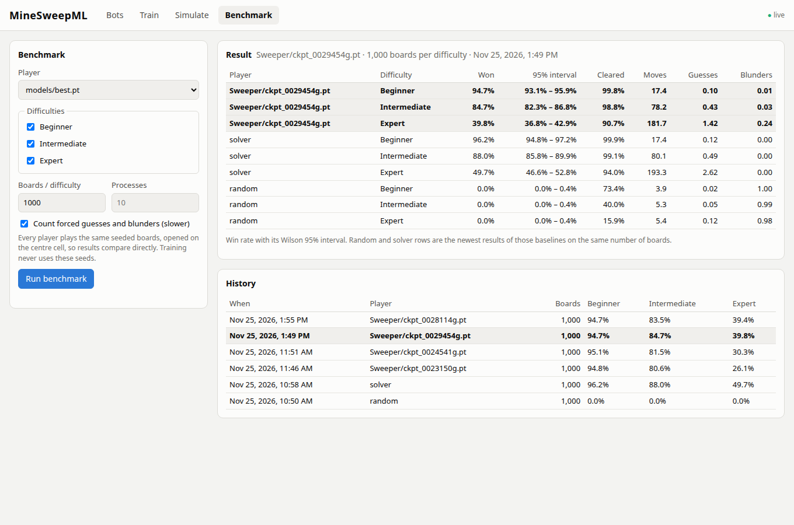

Benchmarks any checkpoint or baseline on fixed boards with a progress bar
and Cancel. The result shows the win rate with its 95% interval, the cleared
share, moves, and optionally forced guesses and blunders, next to the newest
solver and random results on the same number of boards. *History* lists
every benchmark; click one to show it. Results are kept in
`runs/benchmarks.json`. One job (a benchmark or a simulation batch) runs at a
time, in its own processes; it can run alongside training, and both get
slower but give the same results.

## Results

<!-- results:start -->

Generated by `python -m minesweepml report` from bot `Sweeper`.

### The run

| | |
|---|---|
| Hardware | 12th Gen Intel(R) Core(TM) i5-12450H, 12 logical CPUs, 14.8 GB RAM, GPU: none (CPU only) |
| Software | Linux 7.0.0-44-generic, Python 3.14.4, torch 2.15.0+cpu |
| Preset | `hardcore`: 5 workers x 32 games, 4 trainer threads, batch 256, nice 5 |
| Network | 6 residual blocks x 32 channels, 114,913 parameters |
| Training mix | Beginner 20%, Intermediate 30%, Expert 50% |
| Training sessions | 2: preset=hardcore workers=5 0:45:00 wall-clock; preset=hardcore workers=5 0:15:38 wall-clock |
| Training time | 0:45:02 |
| Computer suspended | 1 time(s) during training; 1256s not counted as training time (the laptop slept; corrected after the run) |
| Games played | 29,454 |
| Positions stored | 283,191 |
| Training steps | 2,204 (batch 256) |
| Loss, first -> last logged | 0.5652 -> 0.2612 |

### Benchmark: 1,000 fixed boards per difficulty

Win rate with its Wilson 95% interval. Every player plays the same seeded boards, opened on the centre cell; training never uses these seeds.

| Player | Beginner | Intermediate | Expert |
|---|---|---|---|
| `Sweeper/ckpt_0029454g.pt` | 94.7% (93.1-95.9) | 84.7% (82.3-86.8) | 39.8% (36.8-42.9) |
| rule-based solver | 96.2% (94.8-97.2) | 88.0% (85.8-89.9) | 49.7% (46.6-52.8) |
| random clicks | 0.0% (0.0-0.4) | 0.0% (0.0-0.4) | 0.0% (0.0-0.4) |

| Player | Beginner cleared | Intermediate cleared | Expert cleared |
|---|---|---|---|
| `Sweeper/ckpt_0029454g.pt` | 99.8% | 98.8% | 90.7% |
| rule-based solver | 99.9% | 99.1% | 94.0% |
| random clicks | 73.4% | 40.0% | 15.9% |

Forced guesses (moves with no provably safe cell) and blunders (mines hit while a provably safe cell existed) per game, judged by the solver:

| Player | Beginner guesses / blunders | Intermediate guesses / blunders | Expert guesses / blunders |
|---|---|---|---|
| `Sweeper/ckpt_0029454g.pt` | 0.10 / 0.01 | 0.43 / 0.03 | 1.42 / 0.24 |
| rule-based solver | 0.12 / 0.00 | 0.49 / 0.00 | 2.62 / 0.00 |
| random clicks | 0.02 / 1.00 | 0.05 / 0.99 | 0.12 / 0.98 |

### Checkpoints during training (200 benchmark boards per difficulty)

| Checkpoint | Games | Beginner won | Intermediate won | Expert won |
|---|---|---|---|---|
| `ckpt_0014857g.pt` | 14,857 | 60.5% | 4.0% | 0.0% |
| `ckpt_0017334g.pt` | 17,334 | 84.5% | 37.5% | 0.0% |
| `ckpt_0019913g.pt` | 19,913 | 94.0% | 64.0% | 2.0% |
| `ckpt_0021717g.pt` | 21,717 | 94.5% | 76.5% | 20.0% |
| `ckpt_0023150g.pt` | 23,150 | 93.5% | 83.0% | 28.5% |
| `ckpt_0026578g.pt` | 26,578 | 92.5% | 84.0% | 36.0% |
| `ckpt_0028114g.pt` | 28,114 | 93.5% | 84.5% | 42.0% |

The bundled `models/best.pt` is `ckpt_0029454g.pt`, the checkpoint with the best mix-weighted win rate in the full benchmark (1,000 boards per difficulty), saved without optimiser state (0.49 MB).

### Charts

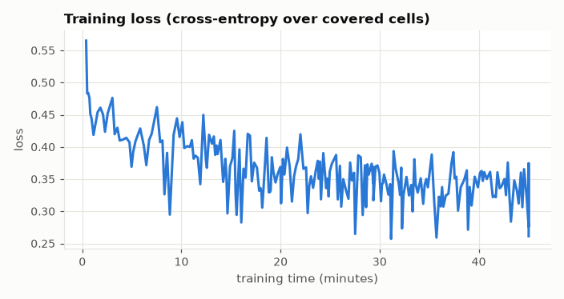
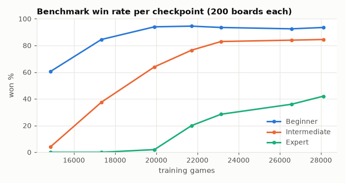
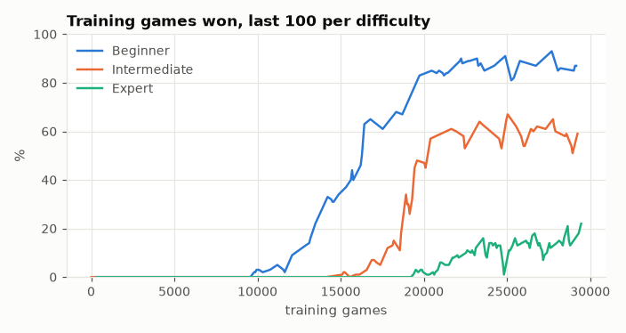
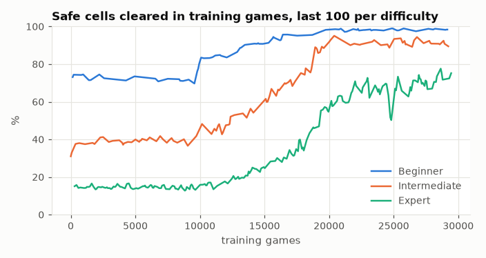
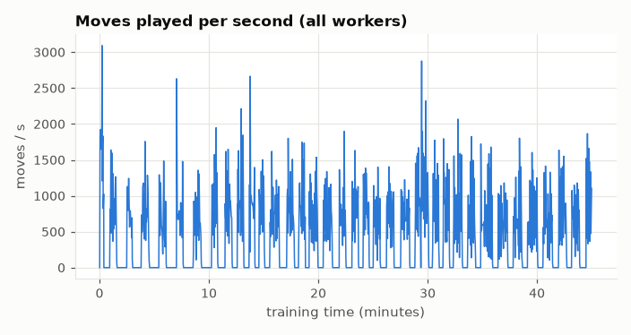
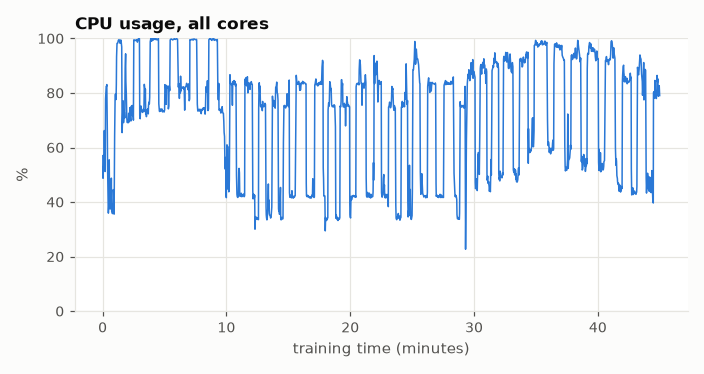

<!-- results:end -->

## Reproducing the results

```bash
# 1. Train: Hardcore preset, 45 minutes of training, a benchmark every 5 minutes
python -m minesweepml train --bot Sweeper --preset hardcore --time 45m --eval-minutes 5

# 2. Baselines and the final checkpoint on 1,000 boards per difficulty, with guesses and blunders
python -m minesweepml evaluate random --boards 1000 --quality
python -m minesweepml evaluate solver --boards 1000 --quality
python -m minesweepml evaluate Sweeper --boards 1000 --quality

# 3. Regenerate the Results section and charts, and export the best checkpoint
python -m minesweepml report --bot Sweeper --export-best
```

The reported run was started from the web interface with the same settings.
The laptop went to sleep 29 minutes into it; the 21 minutes of sleep were
taken out of the training time (training now does this by itself), and a
second session trained for the remaining 15 minutes 38 seconds, so the bot
trained for 45 minutes in total. Workers run in several processes, so two
runs never play identical games, and speed depends on the CPU. Expect the
same trend, not the same numbers.

## Project layout

```
minesweepml/
  board.py       rules: board specs, seeded mine placement with a safe opening, flood fill
  solver.py      rule-based solver: certain cells, exact P(mine) by frontier enumeration
  players.py     random, solver and network players; the batched game loop
  replay.py      game records, deterministic replays, per-move P(mine) for the overlay
  encoding.py    visible board -> 12 input planes with an off-board ring
  network.py     fully convolutional residual network, checkpoint save/load
  workers.py     worker processes that play training games in batches
  trainer.py     replay buffer, optimisation, checkpoints, benchmarks, worker throttling, graceful stop
  benchmark.py   fixed seeded boards, Wilson intervals, guesses and blunders
  runs.py        bot directories: create, edit, rename, delete, checkpoints
  metrics.py     per-bot SQLite metrics
  jobs.py        benchmarks and simulation batches for the web interface
  server.py      FastAPI app, WebSocket events, simulation, replay and GIF endpoints
  gif.py         one game as an animated GIF
  report.py      charts and the Results section of this README
  cli.py         python -m minesweepml {train,evaluate,simulate,gif,serve,report,list}
  static/        web UI (plain HTML/CSS/JS, canvas boards and charts)
models/best.pt   best checkpoint of the reported run (weights only)
tests/           pytest suite
```

## Limitations

- **It does not yet match the solver.** On Expert it wins 39.8% of boards
  against the solver's 49.7%, and it still hits a mine next to a provably
  safe cell about once every four Expert games (0.24 blunders per game; the
  solver makes none). Expert was still improving when training stopped, so
  longer runs help, but slowly on a CPU.
- **Training, not playing, limits the speed.** Each move costs one forward
  pass, each stored position a backward pass too, and convolution training
  on a CPU stops scaling at about 4 threads. During the reported run the
  workers were paused about half of the time.
- **Learning from labels, not rewards.** The network learns P(mine | what it
  sees) from the true mine layouts and plays the safest cell. It never learns
  which of two equally risky cells reveals more information, which is where
  strong solvers gain their last few percent.
- **Exploration costs training games.** With 1% random clicks, a 180-move
  Expert game makes about two blind clicks, so the win rate of training games
  (the chart above) stays well below the benchmark, which plays without
  exploration.
- **Guess counts depend on game length.** Forced guesses are counted per game,
  and a bot that loses earlier has fewer moves left to guess on, so compare
  them only between players with similar win rates.
